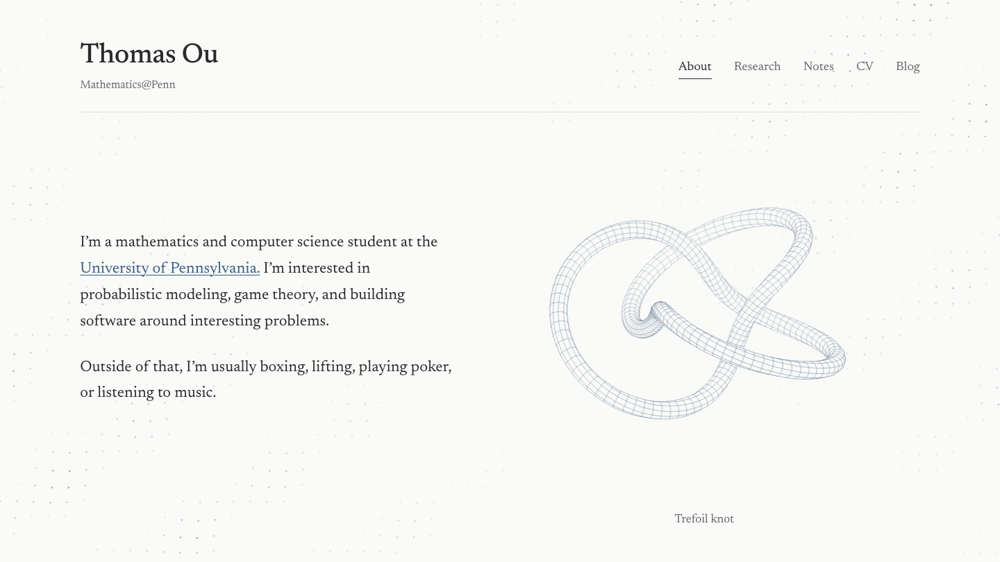
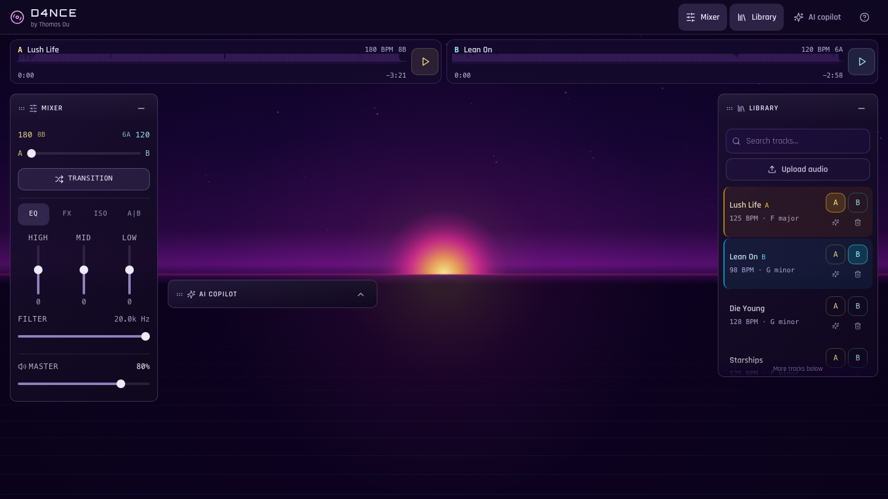
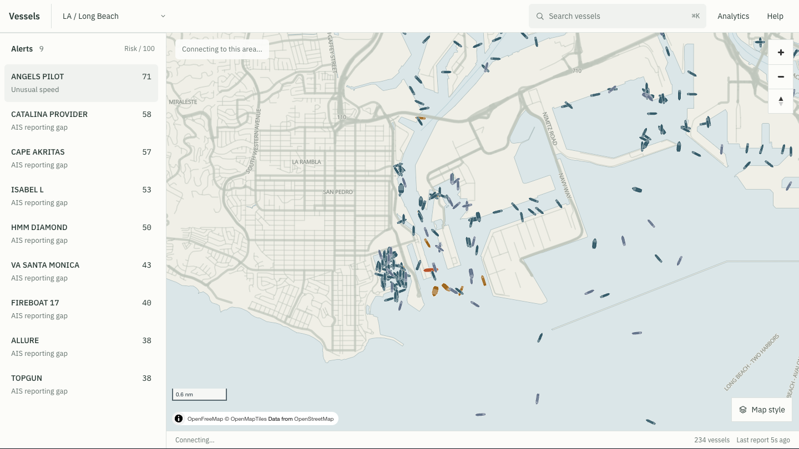
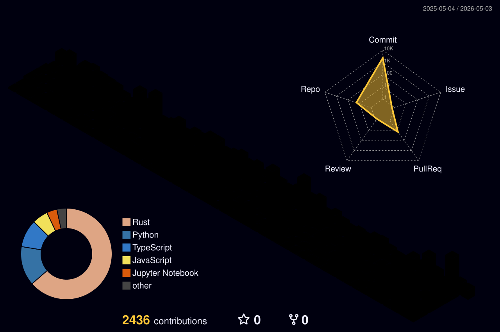

# Thomas Ou

I study math and computer science at Penn. I’m interested in game theory and probabilistic modeling.

[Website](https://thomasou.com) · [LinkedIn](https://www.linkedin.com/in/thomasou0/) · [Email](mailto:contact@thomasou.com)

  

[Selected work](#user-content-selected-work) · [Research](#user-content-research) · [Contributions](#user-content-contributions) · [All projects](#user-content-all-projects)

## Selected work

<table>
<tr>
<td width="50%" valign="top">
<h3><a href="https://github.com/Smokeybear10/conformal-calibration-under-shift">Conformal calibration under new-participant shift</a></h3>

I compared calibration methods for activity recognition when the test person was absent from training and calibration. In the UCI HAR runs, participant balancing improved lower-tail coverage while sending more predictions for review. The notebook includes a second-dataset check on WISDM and the limitations.

<a href="https://github.com/Smokeybear10/conformal-calibration-under-shift">Code</a> · <a href="https://github.com/Smokeybear10/conformal-calibration-under-shift/blob/main/unseen_person_conformal.ipynb">Notebook</a> · <a href="https://github.com/Smokeybear10/conformal-calibration-under-shift/tree/main/results">Results</a> · <a href="https://github.com/Smokeybear10/conformal-calibration-under-shift/blob/main/CONTRIBUTING.md">Contribute</a>

</td>
<td width="50%" valign="top">
<h3><a href="https://thomasou.com">thomasou.com</a></h3>

My research, notes, and writing.

<a href="https://github.com/Smokeybear10/000.CORE.portfolio">Code</a>

</td>
</tr>
<tr>
<td width="50%" valign="top">
<h3><a href="https://dance.thomasou.com">D4NCE</a></h3>

A two-deck DJ app in the browser. Mix manually or control it with text and voice.

<a href="https://github.com/Smokeybear10/001.CORE.d4nce">Code</a>

</td>
<td width="50%" valign="top">
<h3><a href="https://harbor.thomasou.com">Harbor</a></h3>

A vessel map with AIS anomaly detection and satellite imagery.

<a href="https://github.com/Smokeybear10/003.CORE.harbor">Code</a>

</td>
</tr>
</table>

## Research

- [River](https://github.com/Smokeybear10/103.RSCH.river): a poker solver in Rust using counterfactual regret minimization.
- [Versus](https://github.com/Smokeybear10/005.CORE.versus): predicting UFC results with ensemble models and feature attribution.
- [Relay](https://github.com/Smokeybear10/105.RSCH.relay): matching stock moves to news, filings, and earnings transcripts.

## Contributions

- [HarborOS: vessel API pagination and query changes](https://github.com/asrinivasan75/HarborOS/pull/1), merged. Added pagination and replaced per-vessel position and alert queries with joined queries.
- [Chain-Love: explorer schema naming proposal](https://github.com/Chain-Love/chain-love/issues/3256), open proposal. Documented the affected data and a compatibility plan for renaming a verification field.

## All projects

Project index

### CORE

- [thomasou.com](https://github.com/Smokeybear10/000.CORE.portfolio): my personal website.
- [D4NCE](https://github.com/Smokeybear10/001.CORE.d4nce): DJ decks and mixing in the browser.
- [Harbor](https://github.com/Smokeybear10/003.CORE.harbor): vessel tracking and AIS anomaly detection.

### RSCH

- [Conformal calibration under new-participant shift](https://github.com/Smokeybear10/conformal-calibration-under-shift): participant-level coverage and review-rate experiments on UCI HAR and WISDM.
- [Strike](https://github.com/Smokeybear10/100.RSCH.strike): detecting strikes in MMA footage with computer vision.
- [River](https://github.com/Smokeybear10/103.RSCH.river): poker solving with Monte Carlo counterfactual regret minimization.
- [Fortify](https://github.com/Smokeybear10/104.RSCH.fortify): U.S. military invention proposals and research spending, 1888–1920.
- [Relay](https://github.com/Smokeybear10/105.RSCH.relay): connecting stock moves to news and filings.

### PROJ

- [Governor](https://github.com/Smokeybear10/207.PROJ.governor): an extension for setting AI job budgets.
- [Sonder](https://github.com/Smokeybear10/208.PROJ.sonder): screening EV charger sites using 3D scans.
- [Versus](https://github.com/Smokeybear10/005.CORE.versus): UFC fight predictions.

### GAME

- [SWEEPER.EXE](https://github.com/Smokeybear10/300.GAME.sweeper): Minesweeper with classes and relics, styled as a Windows 98 desktop.
- [Zetamax](https://github.com/Smokeybear10/301.GAME.zetamax): timed mental math with ranked rounds and private leagues.

### DATA

- [Music Assets](https://github.com/Smokeybear10/803.DATA.music): audio shared by D4NCE and Zetamax.

### MISC

- [Portfolio 2025](https://github.com/Smokeybear10/902.MISC.portfolio-2025): my first website, now archived.
- [Cursor Boston](https://github.com/Smokeybear10/cursor-boston): a fork of the Cursor Boston community site.

**Tools:** TypeScript · React · Next.js · Python · FastAPI · Rust

More about me

<pre>
xxx xxx xxx xxx xxx xxx xxx xxx xxx xxx xxx xxx xxx xxx xxx   thomas@ou ---------------------------------------------
xxx xxx xxx xxx xxx xx;             .+x xxx xxx xxx xxx xxx   . OS: . . . . . . . . . . . . . . . . . . macOS Sequoia
xxx xxx xxx xxx xxx                         xxx xxx xxx xxx   . Studies: . . . . . . . . . . . Mathematics & CS, Penn
xxx xxx xxx x                                 : xxx xxx xxx   . Host: . . . . . . . . . . . . . . .  Philadelphia, PA
xxx xxx x                                         x xxx xxx   . Kernel: . . . . . . . . . . . . . . .  TypeScript 5.x
xxx xx+                                             xxx xxx   . Shell: . . . . . . . . . . . . . . . . . . zsh + fish
xxx x;                                               xx xxx   . IDE: . . . . . . . . . . . . . . . . . . VS Code, Vim
xxx x                     . ..                        x xxx
xxx                      .: ::: ..                      xxx   . Lang.Programming: . . TypeScript, Python, Rust, OCaml
xxx                       . ::: :..                     xxx   . Lang.Frameworks: . . React, Next.js, FastAPI, PyTorch
xx+                          .: ::.      .: .            xx   . Lang.Real: . . . . . . . . . . . .  English, Mandarin
xx:                  ..  ..  .: ::: ..    . ::: ::       xx
xxx           . .           ..: ;;: :.      .   .:.      xx   . Interests.Physical: . . .  Boxing, Judo, Powerlifting
xxx           . ..       .: ::: ;;: ::: ::: :;; ;;:      xx   . Interests.Hobbies: . . . . .  Chess, Poker, Saxophone
xxx          :: ;;: ::: ::: ::: ;+; ;:; ;;; ++; +;; .    xx   - Selected Work ---------------------------------------
xxx x       .:: ;;+ ;;; ::: ::; ++; ;;; ::; ;++ +;: :   :xx   . Website: . . . . . . . . . . . . . . . thomasou.com
xxx xx      .:: :;: ::. ..: :.: ::: ..: ::. ::: ;:: :.. xxx   . D4NCE: . . . . . . . . . . . . . AI-powered DJ system
xxx xx.     ..: ::: ::: :..       . ::: :;: ::: ::: ::: xxx   . Harbor: . . . . . . . . . . . . maritime intelligence
xxx xxx ..  ... ::: ::: ::: ::: ::; ;;; ;;; ::: ::: ::; xxx   . Research: . . . . . . . . . . . . . . River / Versus
xxx xxx ;:   .. .:: ::: ::: ..   .   .. .:: ::: ::: xxx xxx   . Research: . . . . . . . . . . . . . . . . . . Relay
xxx xxx xxx ... .:: ::    . :+; X+# X+; . : ::: ::: xxx xxx   - Achievements ----------------------------------------
xxx xxx xxx +   ... ::: . . ::: ::: ::: .;; ::: ::x xxx xxx   . USAMO: . . . . . . . . . . . . . .  Honorable Mention
xxx xxx xxx x     . .:: ::    .  .    . ::: ::: :;x xxx xxx   . Putnam: . . . . . . . . . . .  Competitor (Score: 22)
xxx xxx xxx xx       :. ::. .   .   ..: ::: ::: xxx xxx xxx   . AMC 10/12: . . . . . . . .  Distinguished HR (Top 1%)
xxx xxx xxx xxx       . .:: :.. ... ::: ;:: ::: xxx xxx xxx   . Poker: . . . . . . . . . . . . . . SIG + IMC Finalist
xxx xxx xxx xxx         .:: ::: ::; ;;; ;;: .:; xxx xxx xxx   - Contact ---------------------------------------------
xxx xxx xxx xxx ..       .: ::: ::: ;:: :.: ::x xxx xxx xxx   . Email: . . . . . . . . . . . . . contact@thomasou.com
xxx xxx xxx xx+ ... ..        . .:. ... ::: ::x xxx xxx xxx   . Website: . . . . . . . . . . . . . . . . thomasou.com
xxx xxx xxx x$X :.: .:. ..          .:: ::: :;x xxx xxx xxx   . LinkedIn: . . . . . . . . . . . . . . . . . thomasou0
xxx xxx ;X& &$X X:: ::: ::: :.. ... ..: ::: :xx xxx xxx xxx   . GitHub: . . . . . . . . . . . . . . . .  SmokeyBear10
xxx       : &$& $Xx ::: ::: ::: .:: :.. ::: :xX      :x xxx   . Instagram: . . . . . . . . . . . . . . . .  tommy_ou_
</pre>

  

[Instagram](https://www.instagram.com/tommy_ou_/)

## GitHub activity

  

  

